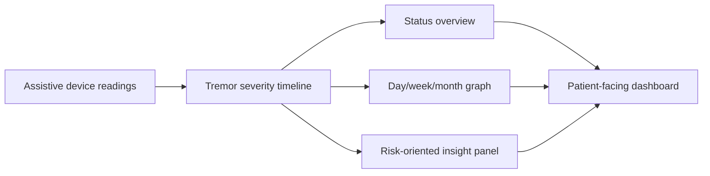

# SnapSteady

SnapSteady is a mobile-first tremor monitoring prototype for people who want to track tremor severity, see recent trends, and review risk-oriented insights in one place.

The objective is to complement a self-stabilizing assistive device with a software interface that helps users understand severity patterns over time.

## Product Flow



## Features

- Mobile-first dashboard for tremor management.
- Color-coded status system for severity at a glance.
- Interactive day/week/month tremor charts.
- Risk-assessment card that distinguishes likely tremor patterns.
- Insight panel for possible lifestyle correlations such as caffeine, sleep, and stress.

## Tech Stack

- Next.js
- React
- TypeScript
- Tailwind CSS
- Recharts
- shadcn/ui-style components

## Getting Started

Install dependencies and start the development server:

```bash
npm install
npm run dev
```

Then open the local URL printed by Next.js, usually:

```text
http://localhost:3000
```

## Status and Safety Notes

This is a prototype interface, not a medical device or clinical diagnostic system. Any future clinical version would need real sensor integration, labelled validation data, clinician review, privacy controls, and regulatory review before being used for medical decisions.

Interested in this area? Email me at praneeth.suresh.s@gmail.com.
