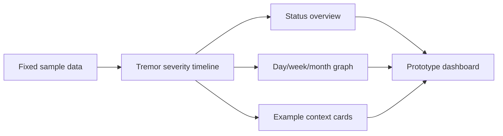

# SnapSteady

SnapSteady is a mobile-first interface prototype for reviewing a tremor timeline. It explores how a dashboard might complement a self-stabilizing assistive device. The current app uses fixed fictional data: it does not connect to a device, analyze anyone’s readings, or run a diagnostic model.

## Product Flow



## Features

- Mobile-first sample dashboard with a color-coded status overview.
- Interactive day, week, and month views over fictional readings.
- Example context cards that illustrate how a future interface might organize observations.

## Tech Stack

- Next.js
- React
- TypeScript
- Tailwind CSS
- Recharts
- shadcn/ui-style components

## Getting Started

From the repository root, install the locked dependencies and start the development server:

```bash
npm ci
npm run dev
```

Then open the local URL printed by Next.js, usually:

```text
http://localhost:3000
```

## Status and Safety Notes

The numbers and charts are placeholders, not health measurements or recommendations. This is not a medical device or clinical diagnostic system. Do not use it to make health decisions. Any future clinical version would need real sensor integration, labelled validation data, clinician review, privacy controls, and regulatory review before being used for medical decisions.

Feedback on the interface is welcome in the repository’s [issue tracker](https://github.com/Praneeth-Suresh/SnapSteady/issues).
